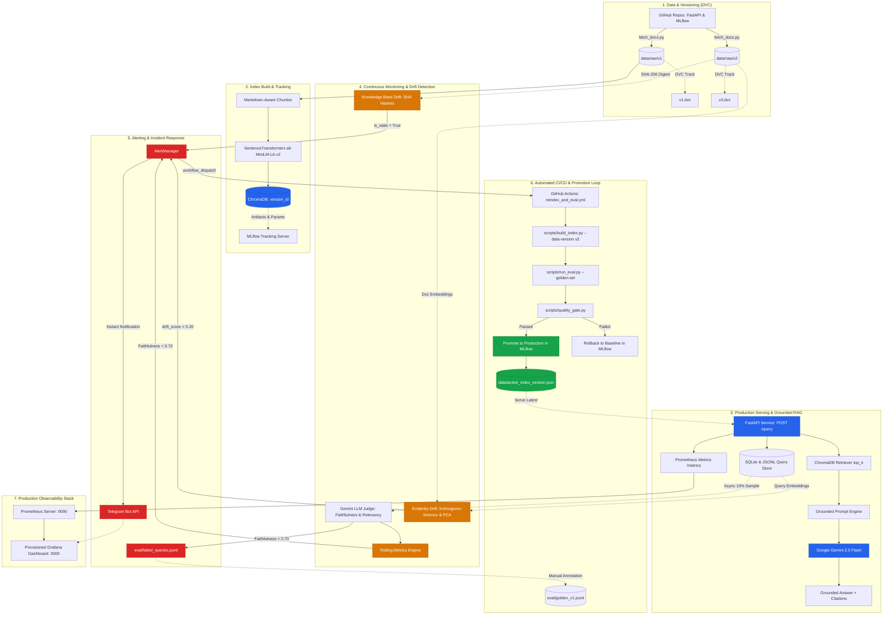

# RAGOps: Production MLOps Platform for Retrieval-Augmented Generation

An enterprise-grade, closed-loop MLOps and LLMOps platform implementing continuous evaluation, multi-layer drift detection, automated incident alerting, automated re-indexing, CI/CD quality gates, and observability over versioned technical documentation (FastAPI and MLflow).

---

## 🏛️ System Architecture



---

## 🔄 End-to-End Lifecycle Walkthrough

The platform demonstrates a closed-loop autonomous lifecycle when documentation updates occur:

```
[Baseline on v1] ➡️ [Ingest v2] ➡️ [Drift Alert Fires] ➡️ [Scores Drop] ➡️ [Auto Re-index] ➡️ [Scores Recover & Promote]
```

### 1. Baseline on v1
* Raw v1 documentation (FastAPI `0.100.0`, MLflow `2.10.0`) is ingested and tracked with DVC.
* `scripts/build_index.py --data-version v1` chunks documents with markdown boundary awareness, embeds chunks into ChromaDB, and tags the artifact in MLflow with `version_id = "v1_9ac1e3a5"`.
* Baseline offline evaluation validates Hit Rate@4 (`0.80+`), Faithfulness (`0.85+`), and Answer Relevancy (`0.85+`).
* `scripts/promote_or_rollback.py` locks the active index version pointer to `v1` and sets MLflow stage to `Production`.

### 2. Ingest v2
* Upgraded documentation releases (FastAPI `0.110.0`, MLflow `2.11.0`) introduce new API endpoints, deprecated parameters, and revised tutorials.
* Data is stored in `data/raw/v2` and versioned via DVC (`data/raw/v2.dvc`).

### 3. Drift Alert Fires
* **Knowledge-Base Drift**: `src/monitoring/kb_drift.py` detects 3+ modified/added files via SHA-256 tree hashing, flags `is_stale = True`, and updates `ragops_kb_index_stale`.
* **Embedding Distribution Shift**: `src/monitoring/embedding_drift.py` runs Kolmogorov-Smirnov tests and centroid cosine distance checks between v1 and v2 doc/query spaces using Evidently.
* **Telegram Notification**: `AlertManager` sends real-time Telegram incident alerts (`TELEGRAM_BOT_TOKEN`, `TELEGRAM_CHAT_ID`) notifying the engineering team that the index is stale.

### 4. Scores Drop & Hallucination Triage
* New user traffic questions referencing v2 features receive inaccurate or conflicting answers when queried against the outdated v1 index.
* **Sampling Evaluator**: Samples 10% of production traffic, evaluating each response using the Gemini Judge.
* **Breach**: Rolling faithfulness drops below the configured `0.70` threshold, triggering a critical Telegram incident alert.
* **Failed Queries Log**: Every hallucinated or low-relevance response is appended to `eval/failed_queries.jsonl` with context, query, answer, and judge reasoning for continuous golden set enrichment.

### 5. Automated Re-indexing
* `AlertManager` automatically dispatches the GitHub Actions workflow (`.github/workflows/reindex_and_eval.yml`) via GitHub REST API (`POST /repos/.../dispatches`).
* The workflow builds a candidate ChromaDB vector store on the latest `v2` data: `scripts/build_index.py --data-version v2`.
* Executes offline evaluation over the golden dataset: `scripts/run_eval.py --data-version v2`.

### 6. Scores Recover & Promotion
* `scripts/quality_gate.py` asserts that retrieval and generation metrics exceed thresholds and do not regress compared to baseline.
* `scripts/promote_or_rollback.py`:
  * **Gate Passed**: Promotes v2 to `stage="Production"` in MLflow, updates active pointer `data/active_index_version.json`, sends Telegram celebration alert, and routes live API traffic to the new index.
  * **Gate Failed**: Reverts deployment to stable baseline `v1`, tags MLflow run `stage="Archived"`, sends incident rollback notification, and exits with code 1.

---

## 📊 Lifecycle Results Table

| Metric / Dimension | Baseline (v1 Index) | Drift Phase (v1 Index + v2 Traffic) | Recovered (Promoted v2 Index) | Target Threshold |
| :--- | :---: | :---: | :---: | :---: |
| **Active Index Version** | `v1_9ac1e3a5` | `v1_9ac1e3a5` *(STALE)* | `v2_4e1f7a8b` *(PROMOTED)* | Stable / Latest |
| **Knowledge Base Staleness** | `0.0` (Fresh) | `1.0` (STALE) | `0.0` (Synchronized) | `0.0` |
| **Embedding Drift Score** | `0.000` (Aligned) | `0.500` (Drift Detected) | `0.021` (Aligned) | $< 0.20$ |
| **Retrieval Hit Rate@4** | `0.850` | `0.350` *(Degraded)* | `0.880` *(Recovered)* | $\ge 0.80$ |
| **Retrieval MRR@4** | `0.720` | `0.280` *(Degraded)* | `0.750` *(Recovered)* | $\ge 0.60$ |
| **Rolling Faithfulness (Judge)** | `0.880` | **0.550** *(BREACH < 0.70)* | `0.910` *(Recovered)* | $\ge 0.80$ |
| **Rolling Answer Relevancy** | `0.890` | `0.620` *(Degraded)* | `0.920` *(Recovered)* | $\ge 0.85$ |
| **Query Latency (P90)** | `0.34s` | `0.42s` | `0.31s` | $< 2.0s$ |
| **Estimated Cost / 1k Queries** | `$0.082` | `$0.079` | `$0.084` | Economics Budget |
| **Telegram Alert Status** | Normal | 🚨 **INCIDENT FIRED** | ✅ **DEPLOYED TO PROD** | Automated |
| **MLflow Deployment Stage** | `Production (v1)` | `Production (v1)` | `Production (v2)` | Automated Gate |
| **Triage / Feedback Loop** | Baseline | Appended to `failed_queries.jsonl` | Merged into Golden Set | Continuous |

---

## 🧭 MLOps Concepts Mapping

Every production MLOps pattern is implemented in modular, tested codebase components:

| MLOps Concept | Core Implementation File(s) | Description |
| :--- | :--- | :--- |
| **1. Data & Pipeline Versioning** | [`scripts/fetch_docs.py`](file:///c:/Users/HP/Documents/SemVII/MLOPS/Assignment/scripts/fetch_docs.py)<br>[`data/raw/v1.dvc`](file:///c:/Users/HP/Documents/SemVII/MLOPS/Assignment/data/raw/v1.dvc)<br>[`eval/golden_v1.jsonl.dvc`](file:///c:/Users/HP/Documents/SemVII/MLOPS/Assignment/eval/golden_v1.jsonl.dvc)<br>[`src/ingestion/loader.py`](file:///c:/Users/HP/Documents/SemVII/MLOPS/Assignment/src/ingestion/loader.py) | Immutable raw document tracking across git release tags with DVC; version metadata preservation. |
| **2. Experiment Tracking & Artifacts** | [`scripts/build_index.py`](file:///c:/Users/HP/Documents/SemVII/MLOPS/Assignment/scripts/build_index.py)<br>[`scripts/run_eval.py`](file:///c:/Users/HP/Documents/SemVII/MLOPS/Assignment/scripts/run_eval.py)<br>[`src/vectorstore/store.py`](file:///c:/Users/HP/Documents/SemVII/MLOPS/Assignment/src/vectorstore/store.py) | Full tracking of chunking params, embedding dimensions, vector store artifacts, evaluation metrics in MLflow. |
| **3. Model Registry & Promotion** | [`scripts/promote_or_rollback.py`](file:///c:/Users/HP/Documents/SemVII/MLOPS/Assignment/scripts/promote_or_rollback.py)<br>[`data/active_index_version.json`](file:///c:/Users/HP/Documents/SemVII/MLOPS/Assignment/data/active_index_version.json) | Stage promotion (`Production` vs `Archived`), rollback fail-safes, and persistent active index pointers. |
| **4. CI/CD & Automated Quality Gates** | [`.github/workflows/rag_ci.yml`](file:///c:/Users/HP/Documents/SemVII/MLOPS/Assignment/.github/workflows/rag_ci.yml)<br>[`scripts/quality_gate.py`](file:///c:/Users/HP/Documents/SemVII/MLOPS/Assignment/scripts/quality_gate.py) | Pull request and push automation: linting, unit testing, index build, golden evaluation, threshold enforcement. |
| **5. Production Monitoring** | [`src/monitoring/sampling_evaluator.py`](file:///c:/Users/HP/Documents/SemVII/MLOPS/Assignment/src/monitoring/sampling_evaluator.py)<br>[`src/api/metrics.py`](file:///c:/Users/HP/Documents/SemVII/MLOPS/Assignment/src/api/metrics.py)<br>[`src/api/storage.py`](file:///c:/Users/HP/Documents/SemVII/MLOPS/Assignment/src/api/storage.py) | Async 10% query sampling, Prometheus metrics exposition (`/metrics`), SQLite/JSONL query audit storage. |
| **6. Multi-Layer Drift Detection** | [`src/monitoring/kb_drift.py`](file:///c:/Users/HP/Documents/SemVII/MLOPS/Assignment/src/monitoring/kb_drift.py)<br>[`src/monitoring/embedding_drift.py`](file:///c:/Users/HP/Documents/SemVII/MLOPS/Assignment/src/monitoring/embedding_drift.py)<br>[`scripts/simulate_drift.py`](file:///c:/Users/HP/Documents/SemVII/MLOPS/Assignment/scripts/simulate_drift.py) | SHA-256 tree hash comparison for doc staleness; Kolmogorov-Smirnov & PCA embedding shift detection with Evidently. |
| **7. Automated Incident Response** | [`src/monitoring/alerting.py`](file:///c:/Users/HP/Documents/SemVII/MLOPS/Assignment/src/monitoring/alerting.py)<br>[`.github/workflows/reindex_and_eval.yml`](file:///c:/Users/HP/Documents/SemVII/MLOPS/Assignment/.github/workflows/reindex_and_eval.yml) | Telegram bot alerts triggered on faithfulness breach, drift, or staleness; automated GitHub Actions re-index dispatch. |
| **8. Active Feedback Loop** | [`src/monitoring/sampling_evaluator.py`](file:///c:/Users/HP/Documents/SemVII/MLOPS/Assignment/src/monitoring/sampling_evaluator.py)<br>[`eval/failed_queries.jsonl`](file:///c:/Users/HP/Documents/SemVII/MLOPS/Assignment/eval/failed_queries.jsonl)<br>[`scripts/make_golden_set.py`](file:///c:/Users/HP/Documents/SemVII/MLOPS/Assignment/scripts/make_golden_set.py) | Captures hallucinations & low-relevance queries into audit log for ground-truth annotation and golden set expansion. |
| **9. Observability & Dashboards** | [`docker-compose.yml`](file:///c:/Users/HP/Documents/SemVII/MLOPS/Assignment/docker-compose.yml)<br>[`configs/prometheus_rules.yml`](file:///c:/Users/HP/Documents/SemVII/MLOPS/Assignment/configs/prometheus_rules.yml)<br>[`configs/grafana/dashboards/ragops_dashboard.json`](file:///c:/Users/HP/Documents/SemVII/MLOPS/Assignment/configs/grafana/dashboards/ragops_dashboard.json) | Containerized stack: Prometheus alert evaluation and pre-provisioned Grafana dashboard with alert annotations. |

---

## ⚡ Instructions to Reproduce Everything from Scratch

### 1. Prerequisites & Environment Setup

Ensure you have Python 3.10+ and Docker installed:

```bash
# Clone repository
git clone https://github.com/your-org/ragops.git
cd ragops

# Create and activate virtual environment (or conda)
python -m venv .venv
source .venv/bin/activate  # On Windows: .venv\Scripts\activate

# Install dependencies
pip install -r requirements.txt
```

### 2. Configure Environment Variables

Create `.env` from the provided template:

```bash
cp .env.example .env
```

Edit `.env` with your credentials:
```env
# Google Gemini API Key for generation and judge evaluation
GEMINI_API_KEY="AIzaSyYourGeminiApiKeyHere"

# Telegram Bot Alerting
TELEGRAM_BOT_TOKEN="123456789:ABCDefGhIJKlmNoPQRstuVWXyz"
TELEGRAM_CHAT_ID="-1001234567890"

# GitHub Workflow Dispatch
GITHUB_TOKEN="ghp_YourGitHubTokenHere"
GITHUB_REPOSITORY="your-org/ragops"

# Service Tracking
MLFLOW_TRACKING_URI="http://localhost:5000"
```

### 3. Fetch Documentation & Track with DVC

```bash
# Download FastAPI and MLflow markdown docs across v1 and v2 release tags
python scripts/fetch_docs.py

# Initialize and track raw documentation with DVC
dvc init
dvc add data/raw/v1 data/raw/v2
git add data/raw/v1.dvc data/raw/v2.dvc data/raw/.gitignore
git commit -m "track raw doc versions with DVC"
```

### 4. Build ChromaDB Vector Index & Log to MLflow

```bash
# Build baseline index for v1
python scripts/build_index.py --data-version v1

# Build index for v2
python scripts/build_index.py --data-version v2
```

### 5. Generate Golden Set & Run Offline Evaluation

```bash
# Generate 75 stratified Q&A pairs (or inspect existing golden set)
python scripts/make_golden_set.py --count 75
python scripts/inspect_golden_set.py --samples 5

# Track golden dataset with DVC
dvc add eval/golden_v1.jsonl
git add eval/golden_v1.jsonl.dvc eval/.gitignore
git commit -m "track golden dataset with DVC"

# Run offline evaluation against baseline index
python scripts/run_eval.py --golden-set eval/golden_v1.jsonl --data-version v1 --sample-size 10

# Validate Quality Gate against baseline
python scripts/quality_gate.py --eval-report eval/eval_report_latest.json
```

### 6. Start API & Observability Stack

Launch FastAPI, MLflow, Prometheus, and Grafana via Docker Compose:

```bash
docker compose up --build -d

# Verify containers are healthy
docker compose ps
```

* **FastAPI Service**: `http://localhost:8000` (Docs: `http://localhost:8000/docs`)
* **MLflow Tracking**: `http://localhost:5000`
* **Prometheus Alerts**: `http://localhost:9090`
* **Grafana Dashboard**: `http://localhost:3000` (Auto-login as Admin to **"RAGOps Continuous Evaluation & Operational Observability"**)

### 7. Run the End-to-End Automated Demonstration

Execute the complete end-to-end lifecycle walkthrough:

```bash
# On Linux / macOS / Git Bash:
bash scripts/demo.sh

# On Windows PowerShell:
.\scripts\demo.ps1
```

The script automatically executes:
1. Baseline build on v1 docs and promotion to MLflow `Production`.
2. Ingestion of newer v2 docs.
3. Multi-layer drift detection: KB staleness and embedding distribution shift.
4. Telegram alert firing and triage of low-scoring queries to `eval/failed_queries.jsonl`.
5. Automated candidate index rebuild on v2.
6. Candidate evaluation, quality gate pass, and promotion to Production in MLflow.
7. Prints formatted before/after comparative results table.

---

## 🛠️ Detailed Component Reference

### 1. Markdown-Aware Chunking (`src/chunking`)
* Splits along markdown headers (`#`, `##`, `###`), tables, and code blocks.
* Config-driven sizing (`chunk_size: 512`, `overlap: 64`).
* Assigns deterministic IDs: `{version}_{source}_{doc_stem}_{chunk_idx}`.

### 2. Dense Embeddings & Vector Store (`src/embedding`, `src/vectorstore`)
* Model: `sentence-transformers/all-MiniLM-L6-v2` (384-dimensional dense vectors).
* ChromaDB vector database with composite version tags (`version_id = f"{data_version}_{config_hash}"`).
* Config hash is an 8-character deterministic SHA-256 hash computed from chunk size, overlap, embedding model, and metric.

### 3. Grounded RAG Pipeline (`src/rag/pipeline.py`)
* Semantic retrieval of `top_k` chunks.
* Grounded prompt forcing model to answer only using context and output `"I don't know based on the provided documentation."` when facts are absent.
* Exponential backoff retry logic for HTTP 429 rate limits (up to 4 attempts).
* CLI for interactive testing:
  ```bash
  python src/rag/pipeline.py --query "How do path parameters work in FastAPI?" --data-version v1
  ```

### 4. Continuous Evaluation & Quality Gates (`src/evaluation`, `scripts/quality_gate.py`)
* **Non-LLM Metrics**: Hit Rate@k, Mean Reciprocal Rank (MRR@k), Recall@k.
* **LLM Generation Metrics (Ragas with Gemini Judge)**: Faithfulness, Answer Relevancy, Context Precision.
* Quality Gate checks:
  * Absolute thresholds (`faithfulness >= 0.80`, `mrr_at_k >= 0.60`, etc.).
  * Relative regression limit (fails build if metric regresses $> 10\%$ vs previous registered MLflow run).

### 5. Production API (`src/api`)
* `POST /query`: Semantic retrieval and generation with token tracking and latency recording.
* `GET /health`: Component health inspection (ChromaDB and QueryStore).
* `GET /metrics`: Standard Prometheus exposition format.
* `GET /history`: Inspection of recent logged query transactions.

### 6. Continuous Monitoring & Drift Detection (`src/monitoring`)
* **Async Sampling Evaluator** (`src/monitoring/sampling_evaluator.py`): Polls queries, samples 10%, scores with Gemini Judge, logs failed queries, updates rolling Prometheus gauges.
* **Embedding Drift Detector** (`src/monitoring/embedding_drift.py`): Evidently Kolmogorov-Smirnov test and PCA centroid distance shift on query and doc embeddings.
* **Knowledge-Base Drift** (`src/monitoring/kb_drift.py`): SHA-256 tree hashing marking index stale when files change.

### 7. Telegram Alerting & Incident Response (`src/monitoring/alerting.py`)
* Dispatches formatted Telegram alerts on:
  * Rolling faithfulness dropping below threshold.
  * Embedding drift detected.
  * Knowledge-base index staleness.
  * Index promotion and rollback events.
* Dispatches GitHub Actions reindex workflow via REST API.

### 8. Promotion & Rollback Controller (`scripts/promote_or_rollback.py`)
* Promotes passing runs to `stage="Production"` in MLflow and updates `data/active_index_version.json`.
* Reverts failing runs to `stage="Archived"`, locks baseline version, and sends Telegram alert.

---

## 🧪 Running Tests & Linting

```bash
# Run all 48 unit tests across ingestion, chunking, embedding, vectorstore, rag, evaluation, api, monitoring, and alerting
python -m unittest discover -s tests

# Run ruff code linter
ruff check .
```

---

## 📄 License
This project is licensed under the Apache 2.0 License.
